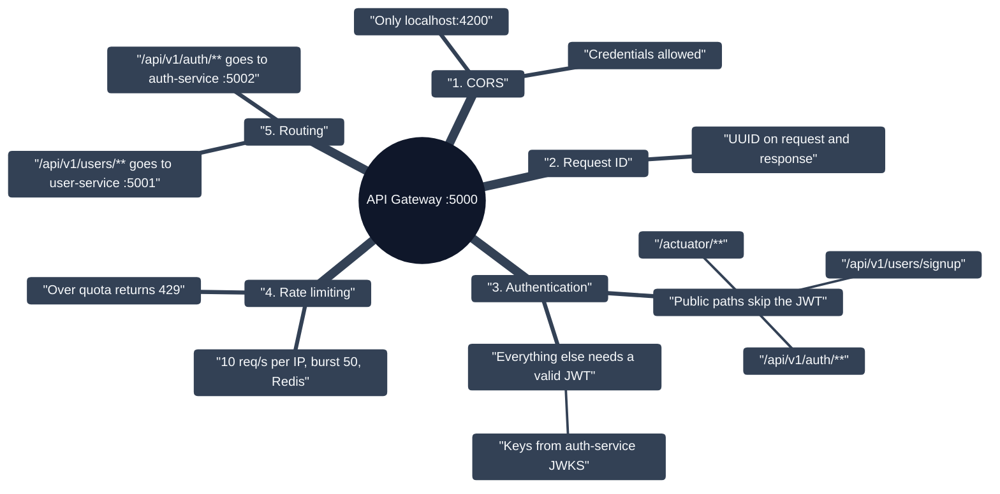
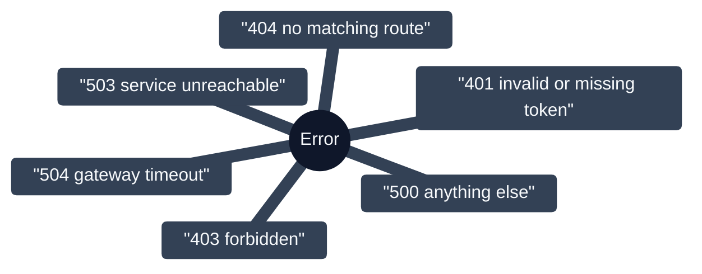

# API Gateway

Single entry point of the backend (`:5000`, Spring Cloud Gateway / WebFlux). Every client request crosses it before reaching a microservice, and every downstream failure is translated into a uniform JSON error.

## Request pipeline

## Error responses

Every failure comes back as the same JSON body: `timestamp, status, code, message, path, requestId`.

