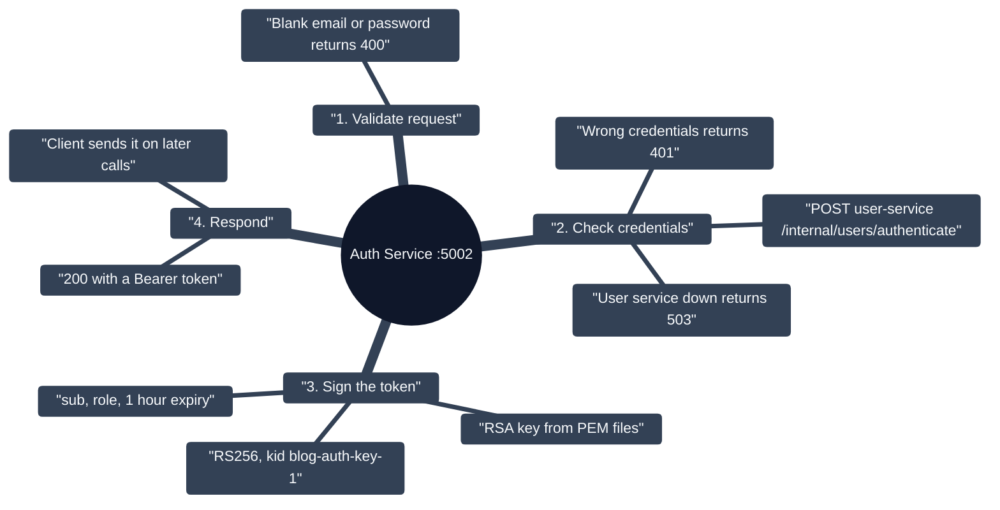
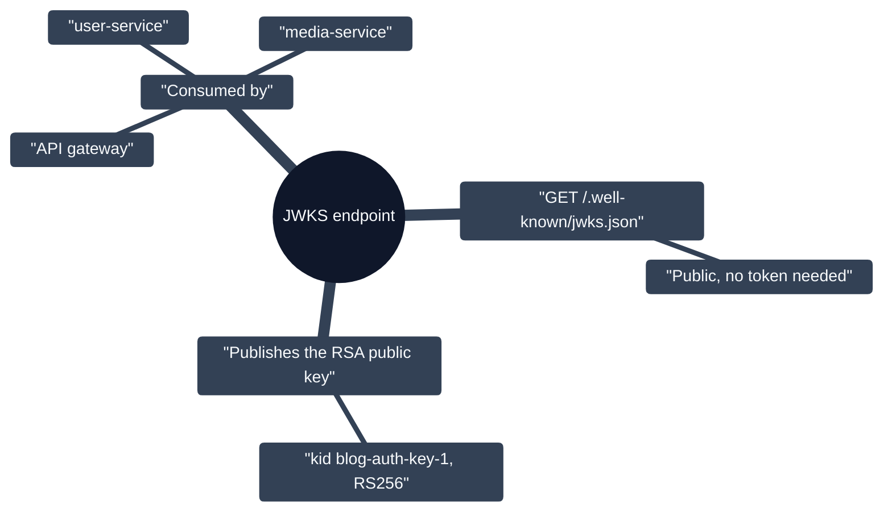

# Auth Service

Login and JWT issuance (`:5002`). It owns the RSA key pair and is the only service allowed to mint tokens; every other service only verifies them.

## Sign-in flow

## Key distribution (JWKS)

**Liveness:** `GET /api/v1/auth/ping` returns `pong`.
