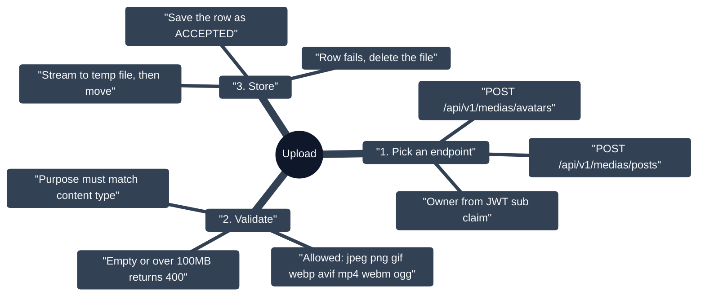
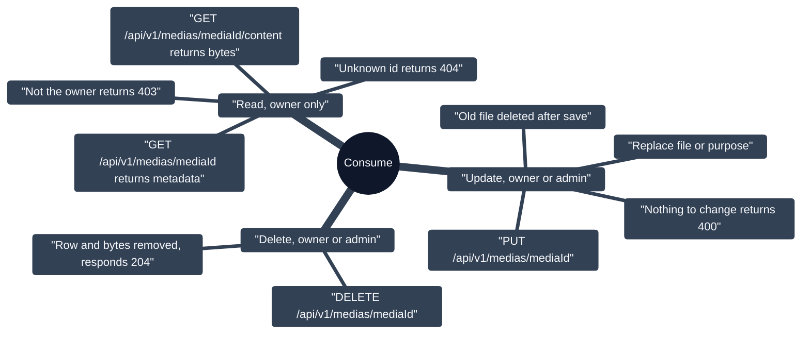
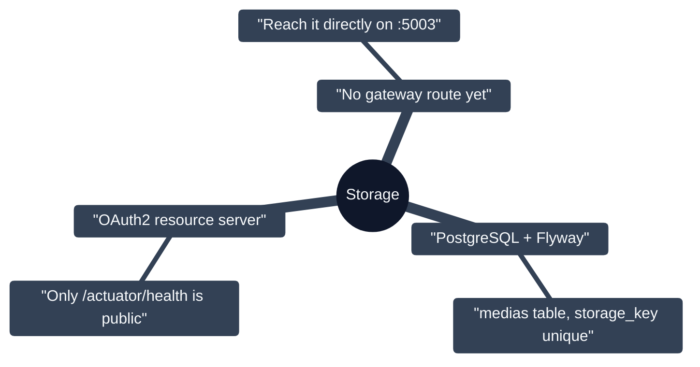

# Media Service

Stores avatars and post images or videos (`:5003`, PostgreSQL + Flyway, local disk storage). Every stored file belongs to exactly one user: reads are owner-only, writes are owner or admin.

## Upload

## Read, update, delete

## Storage and security

