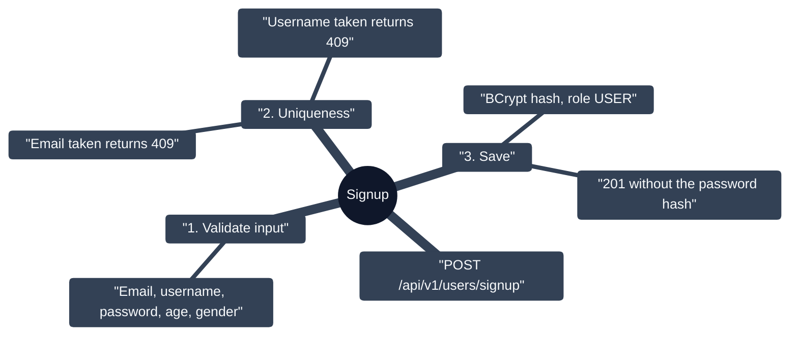
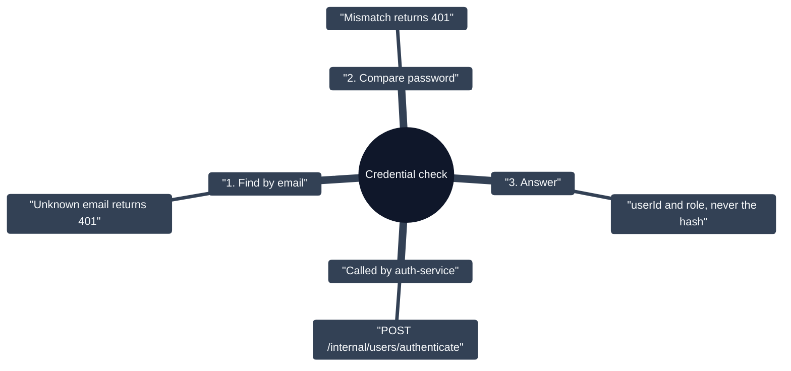
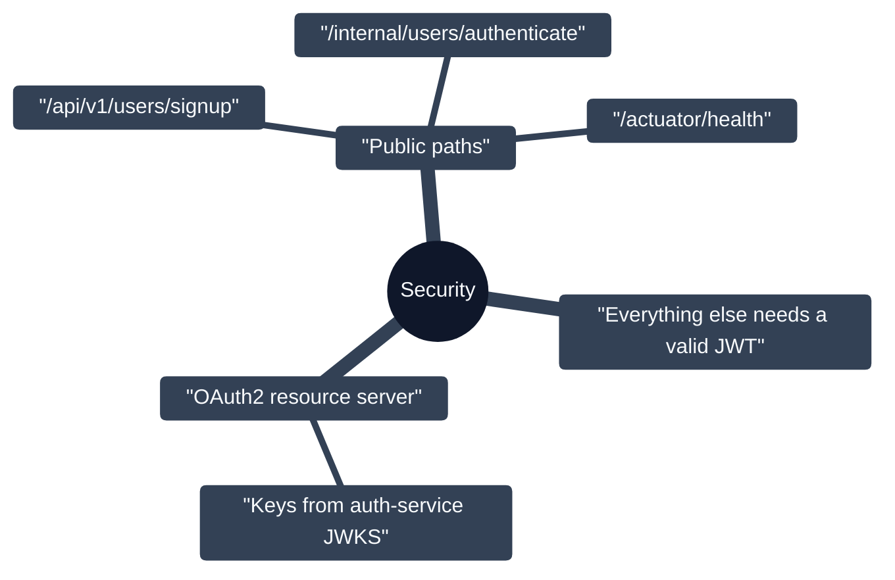

# User Service

Owns user accounts (`:5001`, PostgreSQL + Flyway). Exposes the public signup API, a private credential-checking API used by the auth service, and a "who am I" endpoint.

## Signup (public)

## Credential check (internal only)

## Security

## Notes

- `GET /api/v1/users/me` returns the `userId` from the JWT `sub` claim; `GET /api/v1/users/ping` returns `pong`.
- Flyway migration `V1` creates `users` (unique `email` and `username`, `password_hash`, `age`, `gender`, `role`; `avatar_media_id` reserved for the media service).
